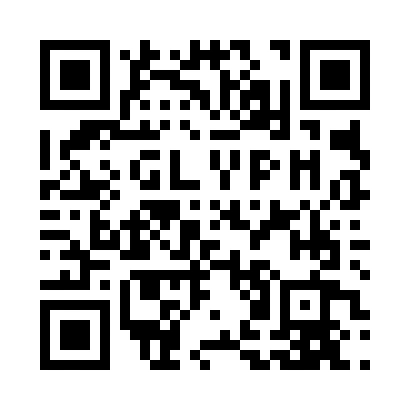
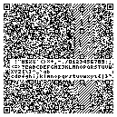
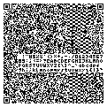
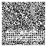
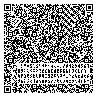

  
  <h1>[fork] Glyph QR</h1>

## Website for generating human-readable QR-codes, a fork of [Noel Friedrich's HQR project](https://www.noel-friedrich.de/hqr)

## Introduction

A great introduction into this problem is [this blogpost](https://research.swtch.com/qart) by Ross Cox.

Main thing this fork changes is it adds new font family - [Pixiie](https://github.com/KK-mp4/pixiie-font-generator).

**Pixiie 3x5 (x-height: 3, ascender: 1, descender: 1) Monospace**

  

**Pixiie 3x4 (x-height: 3, ascender: 1, descender: 0) Monospace**

  

**Pixiie 3x3 (x-height: 3, ascender: 0, descender: 0) Monospace**

  

**Pixiie 2x4 (x-height: 3, ascender: 1, descender: 0) Monospace**

  

## Contributors

